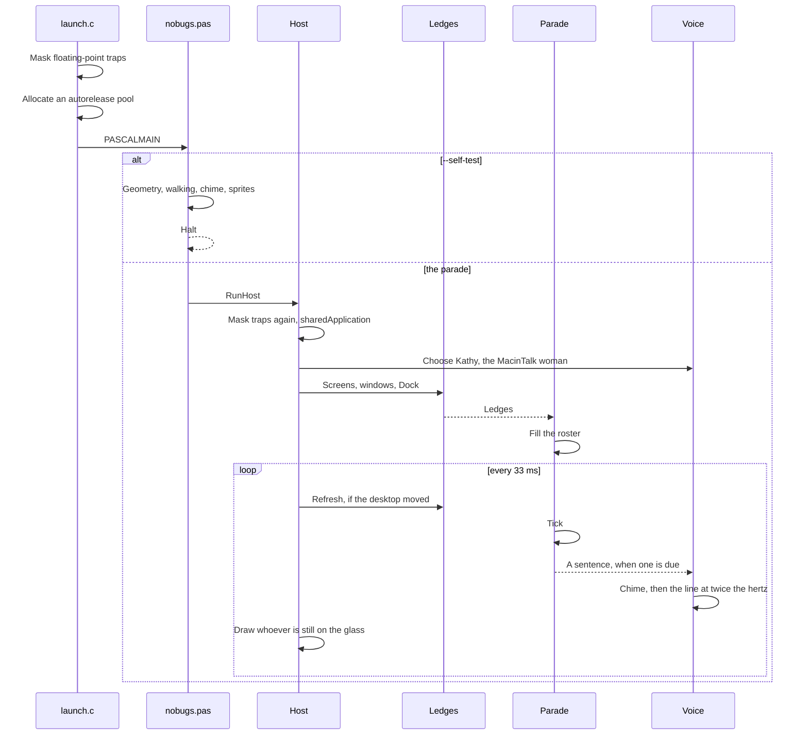

# Execution flow

What happens from the moment the process starts to the moment one frame is on the glass.

## 1. Before Pascal

On macOS the linker pulls in `lib/launch.o`. Its constructor runs before any unit initialization:

1. Read `FPCR`, clear the exception-trap bits, write it back.
2. `objc_getClass("NSAutoreleasePool")`, then `alloc` and `init`.

Windows and Linux do not link that file. They have no Cocoa runtime to appease.

## 2. The program

`nobugs.pas` looks at its arguments.

| Argument | Result |
| --- | --- |
| `--self-test` | Ledges, a walk, a fall, an exit, the WAV header, the voice picker, a non-empty ant. No window. |
| `--preview [path]` | A sprite sheet. Default `bin/preview.bmp`. |
| `--dump` | Print displays, windows and ledges, then exit. Mac host only. |
| `--verbose` | A line twice a second: time, and how many are still here. |
| none | `RunHost`. |

## 3. The host wakes up

On a Mac, `RunHost`:

1. `SetExceptionMask`, then a second autorelease pool nested inside the one from C.
2. `NSApplication.sharedApplication`, activation policy accessory, so there is no Dock icon of its own.
3. Ask `say -v '?'` which voices are installed, and keep Kathy. Samantha, if Kathy is missing.
4. Build the status item. The menu is the only control surface: say it, pause, the about box, quit.
5. Read `NSScreen` frames and visible frames. Read `CGWindowListCopyWindowInfo`. Flip the rectangles. Build ledges. Spawn the roster.
6. One borderless, clear, click-through window per screen, at level 21.
7. Install handlers for SIGINT and SIGTERM. They only set a flag. The timer is what actually calls `terminate`.
8. A timer at 30 Hz, added in `NSRunLoopCommonModes`, so the parade keeps moving while the menu is open.
9. `NSApp.run`.

## 4. One tick

The timer fires on the main thread.

1. If the quit flag is set, terminate and halt.
2. If it has been about half a second since the last look, rebuild the ledges from the live window list. Bugs do not respawn here. They reacquire whatever pavement is under their feet on the next step, or they fall.
3. The first time through, fill the roster to nine.
4. `Parade.Tick(1/30)`. Time steps are capped at 50 ms.
5. For each living bug, advance its state. Walkers who lose their ledge either turn, fall, hop, or commit to leaving. Leavers keep stepping until the sprite is clear of every display. The dead are compacted out. If the headcount is low, one replacement is allowed in after a short delay.
6. If nothing is rendering or playing and a sentence is due, play the chime and ask `say` to write “No! Bugs!” as an 11025 Hz wav, in Kathy’s voice. The claim moves the next deadline out by a random span, so a busy voice does not stack announcements. When `say` exits, the sample rate in that wav is doubled and `NSSound` plays it.
7. Mark every overlay view dirty.

## 5. One draw

AppKit calls `drawRect` because the view was marked dirty. The view finds which screen it belongs to by identity, not by a tag — plain `NSView` has no setter for one.

For each bug whose sprite touches that screen, the host takes the cached `CGImage` and draws it with interpolation off. Feet sit on the ledge. A walking bug bobs by a fraction of a point. The window’s background stays clear, so the pixels that are not a bug are not a window.

## 6. The sentence

The words are not spoken live.

1. `say` writes “No! Bugs!” with Kathy, at 11025 Hz, the rate the utterance was made for.
2. When that process exits, `SoundMasterWav` sets the sample rate in the header to 22050. The samples are not touched, so her pitches move by exactly one octave.
3. `NSSound` plays that lied wav. A shout made for 11025 Hz, played at 22050, finishes in half the time.

A menu click on **Say "No bugs!"** skips the dice and uses that line exactly, still after the chime.

## 7. Stopping

Ctrl-C sets the flag. The next tick calls `terminate` and halts. **Quit No Bugs** sets the same flag. The status item goes with the process.

On Windows the tray icon’s Quit posts the same idea into the message loop and `GetMessage` returns. The shout there is the Kathy wave, played from memory. On Linux, Quit on the panel icon calls `gtk_main_quit`. Ctrl-C sets a flag the timer sees, and that timer is what leaves `gtk_main`. The same Kathy wave is written out once and played with `pw-play`. The overlay is never override-redirect, and it is not given an RGBA colormap unless a compositor is running.
